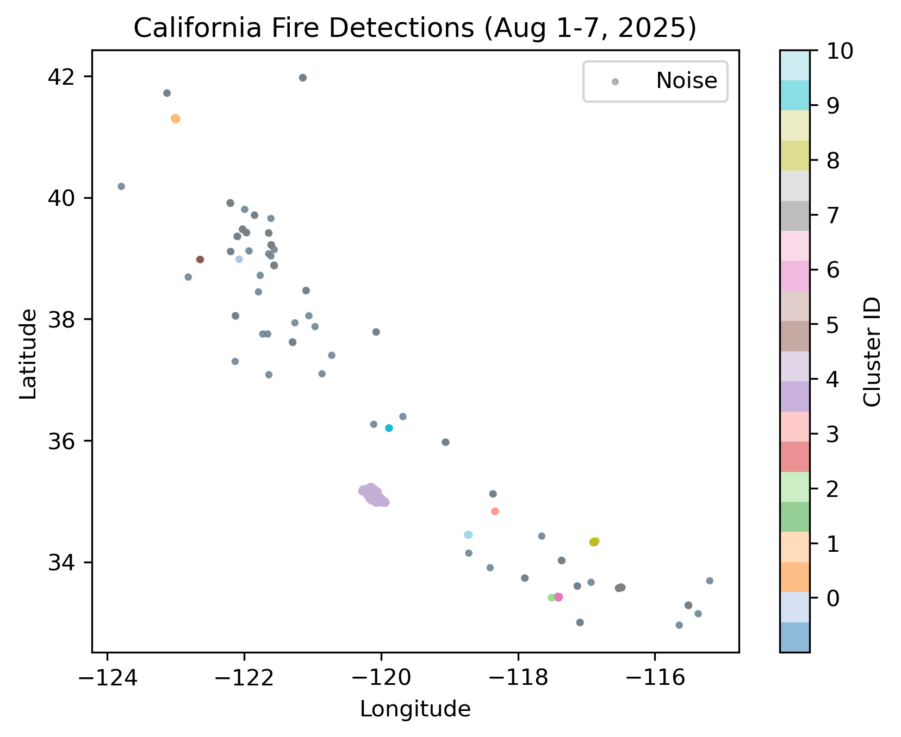

# FireWatch – AI-Powered Wildfire Intelligence

FireWatch is a machine learning project that analyzes historical California wildfire detections using NASA FIRMS satellite data.

## Features
- Wildfire data exploration and preprocessing
- DBSCAN wildfire hotspot clustering
- Geographic visualization of wildfire detections
- Historical wildfire analysis

## Technologies
Python, Pandas, NumPy, Scikit-learn, Matplotlib, Jupyter Notebook

## Data Source
NASA FIRMS (Fire Information for Resource Management System)

## DBSCAN Wildfire Clustering Visualization

## Python Analysis

[View Jupyter Notebook](data_exploration.ipynb)
